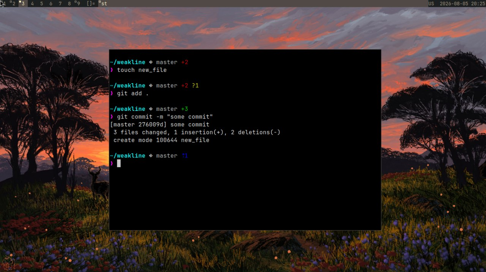

# weakline

A minimal, asynchronous Zsh prompt in Go. Fast enough, clean, and zero framework dependency.


## Features

- **Async Git:** Offloads `git status` to a background worker (one per shell, guarded by `flock`) and redraws the prompt with a `SIGUSR1` signal when the result changes.
- **Honest Git status:** Branch, staged/unstaged/untracked counts, ahead/behind, conflicts, detached HEAD (short commit id). If `git status` hangs past `Timeout`, the prompt shows the branch with a `…` marker instead of stale numbers.
- **Safe:** Directory, branch, and virtualenv names are escaped, so a `%` or an escape sequence in a name cannot break your prompt. Git runs without the repository's `core.fsmonitor` command by default.
- **Fast Enough:** Simple Go buffer formatting, low memory overhead. Rendering only reads a cache file; it never runs git.
- **Color Support:** Named ANSI, TrueColor HEX (`#RRGGBB`, `#RGB`), 256-color codes, and raw SGR (`1;31`).
- **Self-Contained:** Single static binary. No Node, Python, or Zsh plugin managers.

## Trade-offs

- **Go Runtime:** Spawns a full Go runtime on execution (a few milliseconds). Use Rust/C if every millisecond of cold start matters.
- **Zsh Only:** Relies on Zsh-specific prompt hooks and `TRAPUSR1`.
- **Unix Only:** Linux, macOS, FreeBSD, OpenBSD, NetBSD.
- **Git 2.11+:** Uses `git status --porcelain=v2`.

## Comparisons

* **vs Pure:** Keeps the clean layout, but adds granular Git indicators (staged, unstaged, ahead/behind) out of the box.
* **vs Powerlevel10k:** Strips away dozens of unused segments and massive `.p10k.zsh` configs in favor of a single binary.

## Configuration

Weakline relies on compile-time configuration (`config.go`). You tweak icons, timeouts, and colors directly in the code structure before building.

Since the configuration is compiled into a single static binary, you can easily copy your executable across machines without carrying around external config files or dotfiles ecosystems.

Colors accept a name (`red`, `bold_cyan`), a hex value (`#babdbf`, `#fff`), a 256-palette index (`196`), or raw SGR parameters (`1;31`). An unrecognized value becomes an empty (neutral) sequence rather than garbage in your terminal; `make test` checks that the default theme is valid.

Notable options:

| Option | Default | Meaning |
|---|---|---|
| `Timeout` | `5s` | Guard against a *hung* `git status`. The worker is asynchronous, so this is not a latency budget. On timeout the branch is shown with `IconTimeout`. |
| `AllowFSMonitor` | `false` | Let git run the repository's `core.fsmonitor` setting. See Security. |
| `IconDetached` | `@` | Prefix before the short commit id on a detached HEAD. |
| `IconTimeout` | `…` | Marker shown when git status timed out. |

## Installation

Build the binary:
```bash
make
```
Or install it directly to your path (e.g. `~/.local/bin`):
```bash
make install
```
Add initialization to `~/.zshrc`:
```bash
eval "$(weakline init zsh)"
```

## Troubleshooting

### The `…` marker appears

It means one `git status` did not finish within `Timeout` (5 seconds by default), so the counters are unknown. It should be rare. Measure it in the affected repository:

```bash
weakline --diagnose
```

This runs `git status` three times with exactly the flags the background worker uses and prints how long each took (the first run shows the cold-cache cost). If a run is slow, compare with plain git:

```bash
time git status --porcelain=v2 --branch -unormal
```

Common causes of a slow `git status`:

- **`$HOME` is a repository** (dotfiles tracked in `~`). Every directory below it is then "inside a repository" and git scans your whole home. Fix: `export GIT_CEILING_DIRECTORIES="$HOME"` in `~/.zshrc`. Git and weakline then stop looking for a repository at your home directory, so subdirectories are no longer treated as part of it (`~` itself still is).
- **Large untracked directories** that are not in `.gitignore` (`node_modules`, build output, virtualenvs).
- **Submodules**, or a **network / virtual filesystem** (NFS, sshfs, WSL `/mnt/c`).
- **A huge repository** that depends on git's built-in fsmonitor daemon: set `AllowFSMonitor: true` in `config.go` and `git config core.fsmonitor true`. `git config core.untrackedCache true` also helps.
